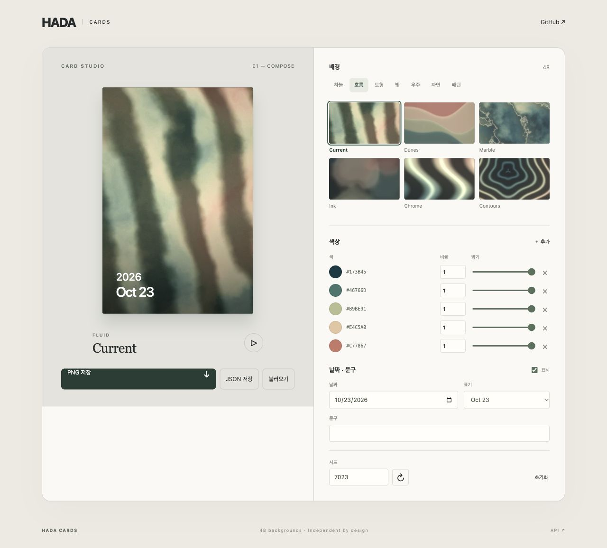

# HADA Cards

48 original generative backgrounds. Mix any colors, choose a seed, then add an optional date and caption. Browser rendering with no service, account or HADA data dependency.

**[Open Card Studio ↗](https://wl39.github.io/hada-cards/)** · [한국어](#한국어) · [API](#api) · [Codespaces](https://codespaces.new/wl39/hada-cards?quickstart=1)

Choose backgrounds, colors and dates in the public editor. No account or installation is needed. GitHub READMEs [remove executable scripts](https://github.com/github/markup#github-markup), so the button opens the editor on GitHub Pages. The complete source is in this repository (`studio/`).

[](https://wl39.github.io/hada-cards/)

## 한국어

배경·색상·날짜를 서로 독립적으로 조합하는 카드 모듈입니다. Studio에서 48개 배경 선택, 색상 추가·삭제, 색상별 비율·밝기, 날짜 형식·문구·시드를 편집하고 PNG 또는 카드 JSON을 저장할 수 있습니다. JSON 불러오기와 브라우저 자동 저장도 지원합니다.

저장소와 편집기를 공개합니다. 위 Card Studio 버튼에서 로그인·설치 없이 바로 편집할 수 있습니다. 작업 내용은 현재 브라우저에 저장되며 PNG·JSON으로 내려받을 수 있습니다. 소스는 MIT 라이선스입니다. HADA에서만 사용하던 외부 라이선스 배경 4개는 포함하지 않았습니다. 소스를 수정하려면 Codespaces 또는 로컬 실행을 사용할 수 있습니다.

## Run the studio

### Public editor

Open **[Card Studio](https://wl39.github.io/hada-cards/)**. Your recipe stays in your browser; download JSON to move it to another device. The site receives no card uploads and has no HADA account connection.

GitHub Actions publishes the studio to GitHub Pages after the Node 22 and 24 checks pass on `main`. HADA also follows verified module changes through its application test and deployment pipeline (see [Updating HADA](#updating-hada)). The [Pages workflow](.github/workflows/ci.yml) follows [GitHub's deployment guide](https://docs.github.com/en/pages/getting-started-with-github-pages/using-custom-workflows-with-github-pages).

### GitHub Codespaces

[Open or resume Card Studio](https://codespaces.new/wl39/hada-cards?quickstart=1). On first use, confirm **Create codespace** on GitHub. The repository's dev container installs dependencies and starts the editor on port **5180**; the forwarded preview opens automatically. If the browser blocks the new tab, open **HADA Card Studio** in the Codespaces **Ports** panel. Restart it with `node scripts/start-studio.mjs` if needed.

[Forwarded ports are private by default](https://docs.github.com/en/codespaces/reference/security-in-github-codespaces); keep 5180 private. This is a personal development workspace, not a continuously hosted shared website. Each collaborator creates their own workspace. Stop the Codespace when finished; [GitHub's included usage and billing](https://docs.github.com/en/billing/concepts/product-billing/github-codespaces) apply.

### Local

Node.js 22.12+ (Node 24 recommended).

```sh
gh repo clone wl39/hada-cards
cd hada-cards
npm ci
npm run dev
```

Open `http://127.0.0.1:5180`. The studio stores only its current recipe in this browser; it sends no card data to a server. `npm run build:studio` produces a static `studio-dist/` folder for any web host. Hosting privacy is separate from repository privacy.

## Install

This package is not published on the npm registry. Install the built archive from the [GitHub release](https://github.com/wl39/hada-cards/releases/tag/v0.1.0):

```sh
npm install https://github.com/wl39/hada-cards/releases/download/v0.1.0/hada-cards-0.1.0.tgz
```

Or build a versioned archive from source:

```sh
npm ci
npm pack
# From your application:
npm install /path/to/hada-cards/hada-cards-0.1.0.tgz
```

HADA commits this archive into `vendor/` and pins its integrity in `package-lock.json`, so production builds need no private GitHub token. Commit the archive and lockfile together when updating a consumer. Runtime core dependencies: **zero**. React is an optional peer used only by `@hada/cards/react`.

## Updating HADA

HADA's production host checks this repository every five minutes. A successful `main` CI run is required. It builds a commit-specific package, generates HADA's server catalog, compiles the combined shaders, runs HADA's frontend/backend tests and production builds, then deploys and checks the application. Failed tests leave the running version in place; failed deployment checks trigger rollback. A HADA source edit or another deployment pauses adoption until that application deployment is finished.

New backgrounds are registered automatically and assigned to the next unfrozen, unreserved weekly slot. Existing cards, earned backgrounds, palette IDs, released weeks and administrator reservations are preserved. HADA keeps a package archive and source/commit lock for reproducible builds. No production credential or self-hosted production runner is configured in this public repository.

To add a background, append its definition to `src/backgrounds.ts` using a new ID and unused index (52 or higher), add its GLSL branch to `src/catalog-shaders.ts` using the existing numbered-comment convention, and add it to `CONTINUOUS_COLOR_THEMES` if applicable. Commit to `main` after review. HADA needs no matching catalog edit. Existing IDs/indices cannot be removed or reassigned. Use a new ID for a different design; a shader fix under the same ID applies to all cards using that background. HADA's four separately licensed backgrounds remain application-specific.

Codespaces is optional. Use the public studio to compose cards, or GitHub's file editor/local development to change the module source. Studio controls edit a card recipe, not repository source code.

## Usage

### Plain JavaScript / TypeScript

```ts
import { createCardRecipe, renderBackground, renderCardBlob } from '@hada/cards';

const recipe = createCardRecipe({
  background: 'current',
  colors: ['#173b45', '#46766d', '#e4c5a0'],
  seed: 7023,
  date: '2026-10-23',
  dateStyle: 'en',
  caption: 'A little progress',
});

const canvas = document.querySelector('canvas')!;
canvas.width = 800;
canvas.height = 1200;
renderBackground(canvas, recipe); // Artwork alone, at time zero
const png = await renderCardBlob(recipe); // 1200×1800, with date and caption
const artwork = await renderCardBlob(recipe, { backgroundOnly: true });
```

Dates never choose the background, palette or seed. Omit `date` for artwork without a date. The same inputs, renderer version and animation phase produce the same composition on the same graphics implementation; small cross-GPU differences are possible. WebGL loss falls back to a simpler Canvas 2D composition.

### React

```tsx
import { createCardRecipe } from '@hada/cards';
import { ArtCard } from '@hada/cards/react';

const recipe = createCardRecipe({
  background: 'mosaic', colors: ['#c77867', '#e4c5a0'], date: '2026-10-23',
});

export function Example() {
  return <ArtCard recipe={recipe} animate showDate style={{ width: 300, borderRadius: 12 }} />;
}
```

The component handles visibility, reduced motion and cleanup. Multiple cards share one GPU renderer and atlas. `animationMode="thumbnail"` reduces calendar-sized surfaces; `boost` briefly accelerates an existing animation when its value changes. React is not imported by the core entry point. `ArtCard` uses a 2:3 surface; use the canvas APIs for other aspect ratios.

### Colors without tasks

```ts
const recipe = createCardRecipe({
  colors: [
    { color: '#173b45', weight: 3 },                 // Three shares, fully revealed
    { color: '#e4c5a0', weight: 1, completed: 0.5 }, // One share, half revealed
  ],
});
```

`weight` controls area proportion. `completed` is an amount from zero to `weight`, defaulting to `weight`; it controls saturation and brightness, not a requirement to supply tasks. Hex colors use `#RRGGBB`. The core supports up to 256 colors; the studio's add button offers up to eight. An empty palette uses a neutral fallback. The calendar formatter takes `YYYY-MM-DD` with no timezone conversion.

## API

| Export | Purpose |
| --- | --- |
| `createCardRecipe(options)` | Create and validate a serializable v1 recipe; no wall clock or account input |
| `BACKGROUNDS` | 48 definitions with stable IDs, labels, families and shader indices |
| `renderBackground(canvas, recipe, time?)` | Draw artwork alone to a supplied canvas |
| `createPaletteTexture(colors)` | Create the two-row RGBA palette texture independently |
| `formatCardDate(date, style?)` / `cardDateLines(recipe)` | Format only the date, without a DOM |
| `drawCardOverlay(context, recipe, width?, height?)` | Draw date/caption over any existing 2D canvas |
| `renderCardBlob(recipe, options?)` | PNG export, optionally without any text or shading |
| `renderCardDataUrl(recipe)` | Cached 240×360 artwork-only WebP preview |
| `animateCard(canvas, recipe, options?)` | Animate a 2:3 card; returns an unsubscribe function |
| `boostCard(canvas)` | Briefly accelerate an existing animation |
| `parseCardRecipe(json)` | Validate JSON, discard unrelated fields and preserve the composition |
| `createCardRenderer(config?)` | Own a separate renderer or provide application-specific shader extensions |

`RenderOptions`: `width` (64–2400), `height` (96–3600), `backgroundOnly`, `time` (non-negative seconds, default 0). Aspect ratio defaults to 2:3. The React preview animates from time zero; PNG export defaults to the reproducible time-zero frame, rather than capturing the current animation frame.

Call the unsubscribe function when removing an animated canvas. Call `renderer.dispose()` when permanently discarding a custom renderer. Pure recipe, date and palette helpers work without a DOM; rendering needs a browser with Canvas 2D (and WebGL for full artwork).

### Application-specific backgrounds

Use `createCardRenderer({ backgrounds, continuousThemes, fragmentSource })`, pass the instance to `<ArtCard renderer={renderer} .../>`, and use the same instance for exports. The `@hada/cards/shaders` entry exposes `vertexSource`, `fragmentSource`, and `createFragmentSource({ functions, dispatch })` for GLSL extensions. Extension code is trusted application code, never user-entered text. Supply the complete background catalog including built-ins; preserve existing indices.

HADA keeps scheduling, unlocks, future-card visibility, task-to-color aggregation and historical recipes in the application. Only rendering and composition live here. Reserved indices 4–7 keep HADA's licensed extensions compatible without distributing them. See [NOTICE.md](NOTICE.md).

## Development

```sh
npm test
npm run check
npm run build:studio
npm pack --dry-run
```

CI checks types, renderer scheduling, palettes, dates, recipe validation and the studio build. `src/` contains the reusable module; `studio/` is one consuming application. Built ESM and TypeScript declarations are included in npm archives. No database migration is needed to adopt this package.

[MIT](LICENSE) · Copyright © 2026 wl39
